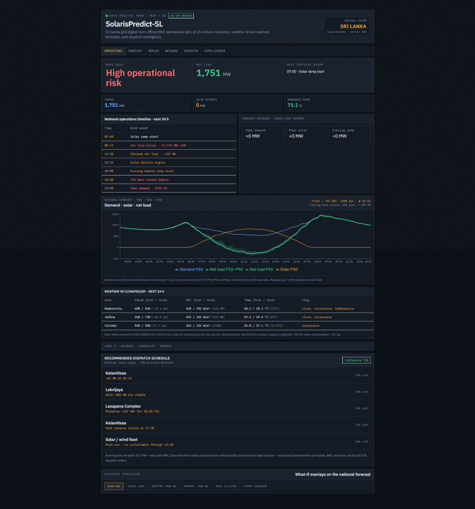
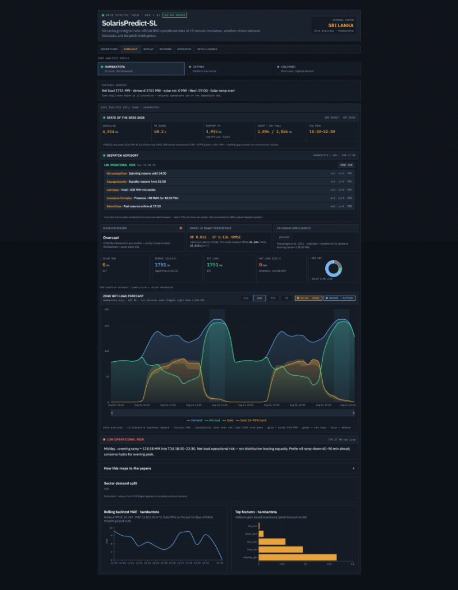
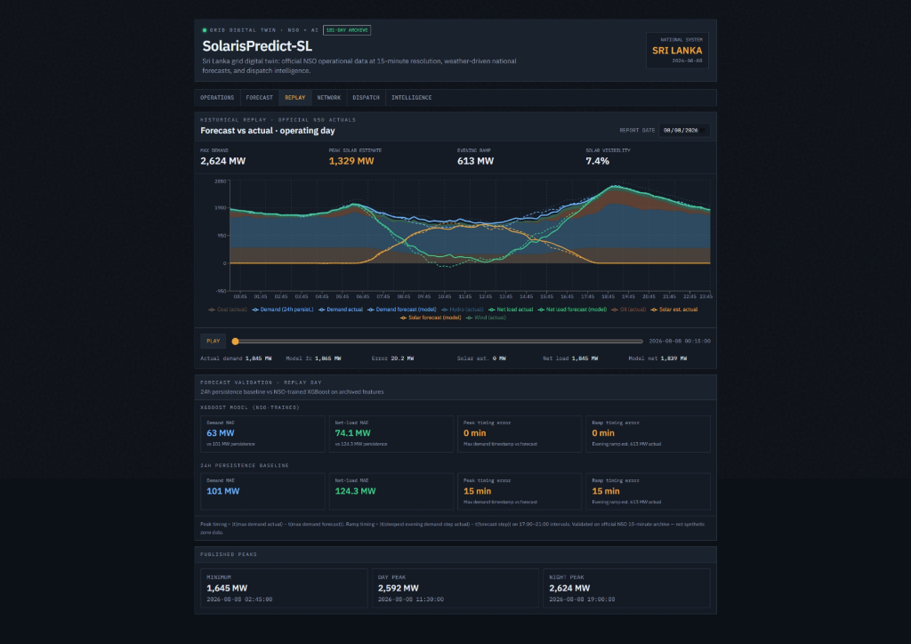
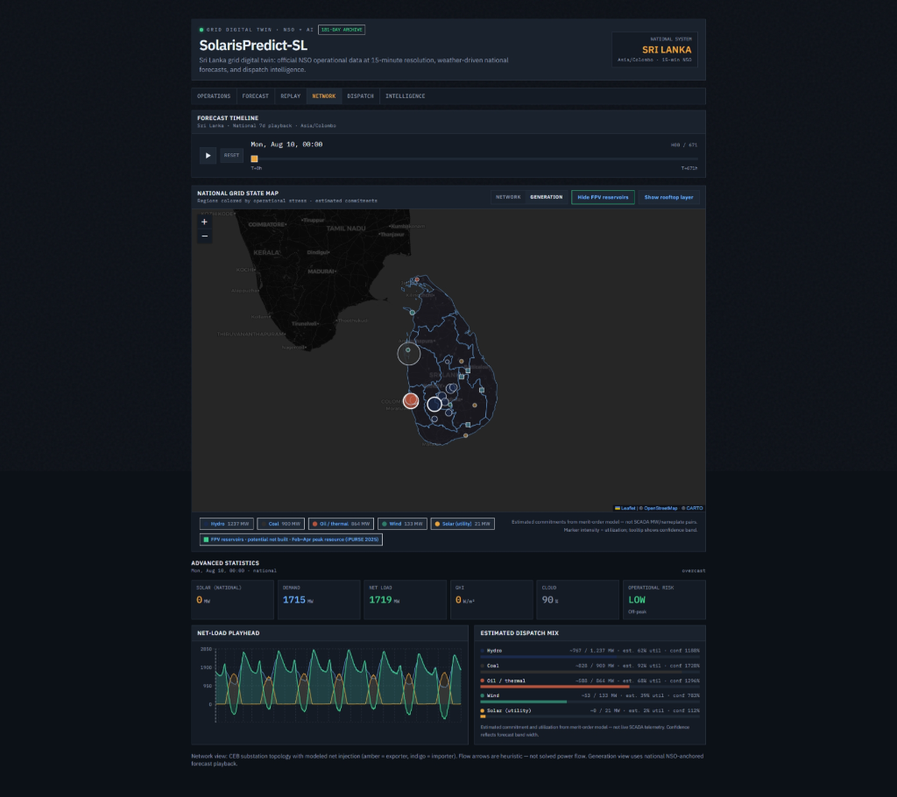
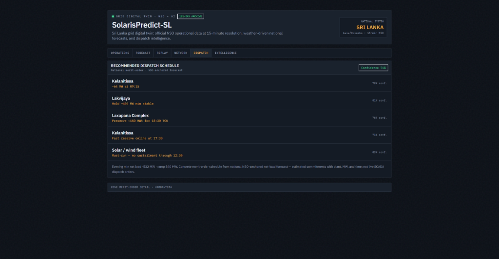
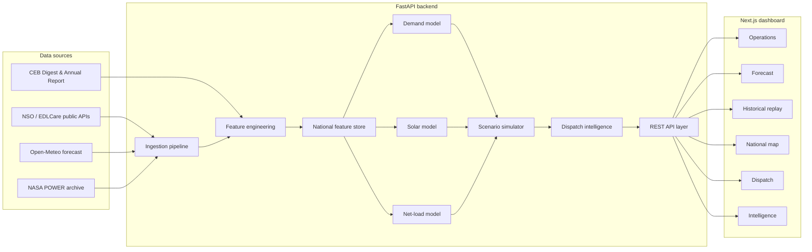
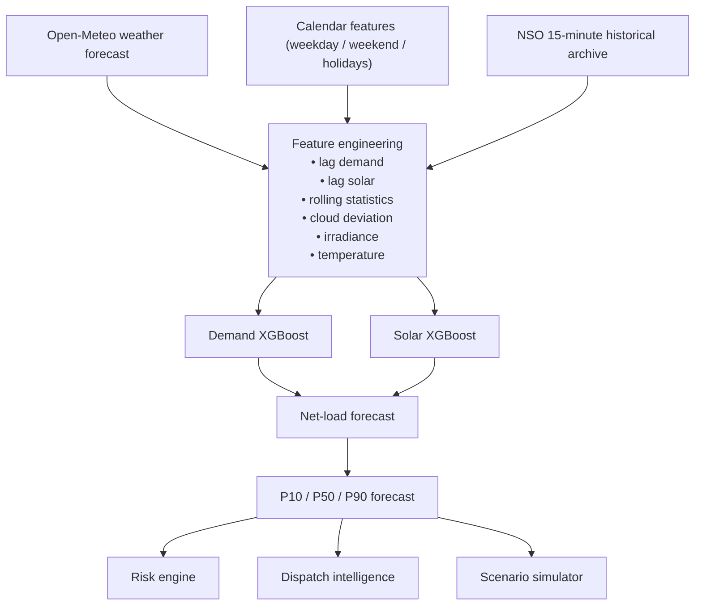
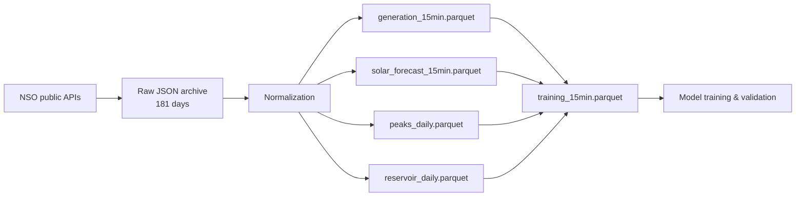
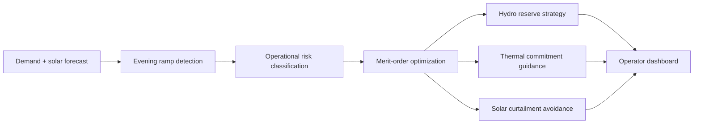

# SolarisPredict-SL

> **An AI-powered grid digital twin for Sri Lanka providing weather-driven national net-load forecasts and dispatch intelligence to optimize renewable integration.**


Rooftop solar is already system-scale (~1.9 GW). Operators need to see **demand − solar** hours ahead — not solar or load alone — so they can ramp oil down, hold hydro for the evening TOU peak, and avoid curtailing solar by default.

SolarisPredict-SL combines zone forecasts, a national plant map with time playback, and a merit-order **dispatch advisory**. Estimates come from live weather plus published demand patterns. Labeled **EST mode / NOT SCADA** on purpose.

---

## 🌟 Value Proposition

- **Prevents Renewable Curtailment:** By accurately forecasting net-load, grid operators can proactively stage flexible thermal and hydro generation, minimizing unnecessary solar and wind curtailment.
- **Reduces Operational Risk:** Provides clear, actionable dispatch advisories (e.g., when to hold hydro reserves or spin up fast thermal plants) hours ahead of critical ramps.
- **Enhances Grid Visibility:** Consolidates disparate weather data, estimated rooftop solar capacity, and regional demand into a single, cohesive national dashboard.
- **Cost Efficiency:** Optimizing the generation mix and reducing reliance on expensive peaker plants during non-critical hours lowers overall operational costs.
- **Accelerates Green Transition:** Builds confidence in handling higher penetrations of variable renewable energy (VRE) by providing data-driven operational intelligence.

---

## 📸 Dashboard Gallery

### Operations console



### Zone analysis



### Historical replay



### National transmission map



### Dispatch intelligence



---

## 📊 Retrospective Research Prototype Scope & Evaluation

> **Research Prototype & Data Notice:**  
> SolarisPredict-SL is an exploratory, weather-driven research prototype for retrospective analysis of NSO generation-mix and solar-estimate records, a constructed net-load proxy and illustrative heuristic advisory rules. The published archived XGBoost scores were obtained with contemporaneous archived weather and row-shifted lags and do not establish forecast-origin accuracy. The `net_load_mw` training label is `G - P` (NSO generation sum minus NSO photovoltaic estimate), not independently measured physical net load. Advisory outputs are hypothetical and not grid dispatch instructions.  
>  
> The current source tree at commit `cf0abb84fbf9a440e1e0caa19dbe1e0a90c0d577` excludes the historic NSO raw and derived observation-level files. Old commit objects can remain accessible; no rights to redistribute underlying NSO/EDL records are asserted. Any downstream collection must comply with the source provider's conditions.

Historical baseline evaluation across Sri Lankan NSO operational intervals (2026-02-10 → 2026-08-09):

| Model Task | Metric | Notes |
|---|---|---|
| Generation Sum ($G$) | Retrospective MAE | Evaluated against contemporaneous archived weather |
| Solar Estimate ($P$) | Retrospective MAE | Evaluated against contemporaneous archived weather |
| Net Load Proxy ($Q = G - P$) | Retrospective MAE | Retrospective proxy index; not operational SCADA net load |

## 💡 Why this exists

In February 2025, Sri Lanka’s grid faced a blackout when solar was meeting over half of national demand. Curtailment later spread beyond “Sunny Sundays.” The operational bottleneck is visibility: without a **net-load** forecast, flexible thermal and hydro cannot be staged early enough, so solar gets cut.

Academic work here typically forecasts solar *or* demand. This project forecasts them **together** and turns the result into a recommended action.

---

## 📦 What you get

| Surface | Purpose |
|---------|---------|
| **Forecast** | Solar, demand, and net load on one timeline (24h–7D), with a solar uncertainty band and net-load risk threshold |
| **Dispatch advisory** | Merit-order guidance: flex oil first, hold coal at minimum stable, conserve hydro for TOU peak (18:30–22:30), keep solar must-run when net load allows |
| **National map** | Plant markers by fuel type, timeline playback tied to zone forecasts, illustrative rooftop layer (~1,935 MW), FPV candidate sites |
| **Methodology** | Sources, model choice, and explicit limits of the estimate |

**Zones:** Hambantota (dry zone / Buruthakanda), Jaffna (northern load), Colombo (highest demand / wet-zone cloud volatility).

---

## 🏗️ System Architecture




## 🚀 Quick start

### Option A — one command

```powershell
# Windows (PowerShell)
pwsh -File scripts/dev.ps1
```

```bash
# macOS / Linux
./scripts/dev.sh
```

First run creates the Python venv, installs pinned backend dependencies and npm packages automatically, then starts both services.

### Option B — manual

1. Backend:

```bash
cd solaris-backend
py -m venv .venv
.venv\Scripts\activate          # macOS/Linux: source .venv/bin/activate
py -m pip install -r requirements.txt

# Optional — pull NASA POWER history and retrain zone models
py -m app.data_pipeline
py -m app.train_solar_model

py -m uvicorn app.main:app --reload --host 0.0.0.0 --port 7860
```

2. Frontend:

```bash
cd solaris-frontend
npm install
npm run dev                     # defaults to http://localhost:7860 for the API
```

Open [http://localhost:3000](http://localhost:3000).

### Configuration

| Variable | Where | Default | Purpose |
|----------|-------|---------|---------|
| `NEXT_PUBLIC_API_URL` | frontend `.env.local` | `http://localhost:7860` | Backend base URL (set in Netlify UI for production) |
| `SOLARIS_CORS_ORIGINS` | backend env | localhost origins + Netlify site | Comma-separated browser origins allowed by the API (`*` allowed, credentials disabled) |

### Run the tests

```bash
cd solaris-backend
.venv\Scripts\python -m pytest tests -q    # 20 hermetic tests, no network needed
```

---

## 🧰 Tech Stack (Detailed)

- **Frontend:** Next.js 14, React, TypeScript, TailwindCSS, Recharts, Leaflet / react-simple-maps  
- **Backend:** Python, FastAPI, Uvicorn, XGBoost, scikit-learn, pandas, numpy  
- **Data Integrations:** NASA POWER API, Open-Meteo API (no API key required)  

---

## 🔮 Forecasting Pipeline



## 📡 Historical Data Pipeline



## ⚡ Operational Intelligence Loop




## 📡 API (backend)

Interactive docs: [http://localhost:7860/docs](http://localhost:7860/docs)

| Endpoint | Description |
|----------|-------------|
| `GET /health` | Liveness, zones, NSO archive metadata |
| `GET /ops/briefing` | National Grid Briefing from latest archived NSO interval |
| `GET /ops/dispatch-schedule?hours=168` | Merit-order dispatch schedule (plant, MW, time) |
| `GET /ops/replay?day=YYYY-MM-DD` | Historical day reconstruction from the archive |
| `GET /ops/replay/dates` | Available replay dates |
| `GET /ops/accuracy?window_days=7` | Rolling forecast accuracy vs archive actuals |
| `GET /ops/visibility` | Solar visibility index (rooftop share vs SCADA) |
| `GET /ops/weather-anomaly?hours=24[&zone=]` | Forecast vs NASA POWER climatology deviation |
| `GET /ops/models` | XGBoost holdout metrics + archive metadata |
| `GET /forecast/national?hours=168` | 7-day national demand/solar/net-load (15-min) |
| `GET /forecast/national/scenario` | Scenario simulator (cloud, outage, wind collapse…) |
| `GET /forecast/solar?zone=&hours=48` | Hourly GHI / solar MW from Open-Meteo + XGBoost |
| `GET /forecast/solar/quantiles?zone=` | P10/P50/P90 solar uncertainty bands |
| `GET /forecast/netload?zone=&hours=48` | Solar + demand → net load and risk signals |
| `GET /backtest?zone=` | Holdout RMSE / MAE from the last training run |
| `GET /evidence/solar?zone=` | Literature benchmarks + this build's metrics |
| `GET /stats/national` · `/stats/ceb-baseline` | Live national snapshot · CEB Digest reference |
| `GET /grid/network?hours=&point_index=` | Transmission nodes with modeled net injection |
| `GET /map/fpv-reservoirs` · `/rooftop/sample` | FPV candidates · rooftop solar sample |
| `GET /advisory/dispatch?zone=&hours=` | Zone merit-order advisory |
| `GET /calendar?hours=48` | Calendar features (weekend / Poya / holidays) |

Zones: `hambantota` · `jaffna` · `colombo` · `hours` 1–168.

---

## 🧠 Models & data

| Piece | Approach |
|-------|----------|
| **Solar** | Per-zone XGBoost on NASA POWER history; live drive from Open-Meteo radiation / cloud / temp |
| **Demand** | Illustrative Sri Lanka load curve — weekday / weekend / Poya / New Year multipliers from published patterns |
| **Net load** | `demand − solar`, with a net-load risk band when the midday dip gets dangerous |
| **Dispatch** | Merit-order rules + confidence — not live CEB SCADA |

---

## 📚 Data Sources

- **NSO / EDLCare public generation APIs** — 15-minute operational archive
- **Open-Meteo** — live weather forecasts
- **NASA POWER** — historical solar irradiance
- **CEB Statistical Digest 2025** — national grid statistics
- **CEB Annual Report 2023** — operational context


## 📂 Repository layout

```
AI Challenge/
├── solaris-backend/     # FastAPI + XGBoost backend, NSO archive, tests/
├── solaris-frontend/    # Next.js dashboard
├── scripts/             # One-command dev launchers (dev.ps1 / dev.sh)
├── docs/screenshots/    # README images
└── README.md
```

More detail: [solaris-backend/README.md](solaris-backend/README.md) · [solaris-frontend/README.md](solaris-frontend/README.md)

---


